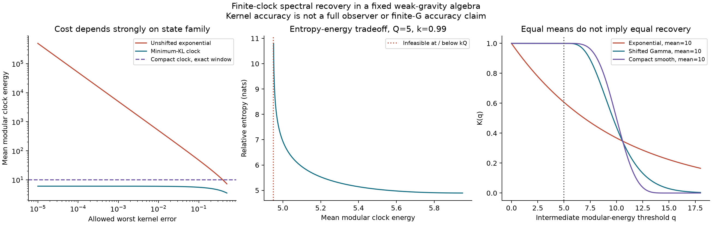
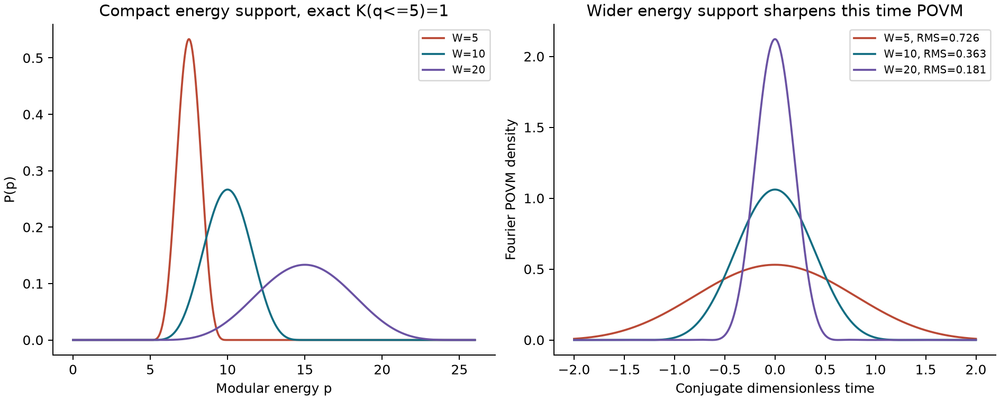

# 有限量子钟的关联函数恢复与资源成本

2026-10-29 阶段研究稿。对象是 de Sitter 静态补丁的弱引力观察者代数；本阶段没有构造新的完整全息对偶。

## 结论

我们把已有的重钟恢复公式转化为一个可解析求解的有限资源问题：给定中间模能量范围和核误差，求相对于迹态的最小熵成本，并加入平均钟能量约束。结果表明，单参数指数钟在高精度下的能量发散不是全部允许钟态的普遍限制。

进一步构造一个有限能量支撑的钟波函数，使有限谱窗内的核精确恢复，同时具有有限的协变时间 POVM 方差。这排除了“改进只能依赖时间方差发散或无限高能尾”这两种解释。

另一个关键结论是负面的：在固定哈密顿量、固定算符组和绝对可积谱振幅下，恢复对所有实时间可以是一致的。不能从能量极限的非一致性直接推断晚时失效；本阶段的核也不能解释引力反扰乱。

这是已有代数框架中的数学推导与构造性检验，使用了标准相对熵方法。文献检索尚不足以确认新颖性或优先权，不能将它宣传为首次发现的量子引力定理。

## 为什么选择这个问题

本阶段先核查了二十二篇主要原始论文：十篇观察者与算符代数文献，十二篇候选微观模型文献，另追踪相关参考。详细记录见 [观察者综述](../literature/observers.md) 和 [候选模型综述](../literature/models.md)。

核查改变了最初的选题直觉。一般 n 点谱尾核在 [Han–Hu 2610.14175v1，式(45)—(51)](https://arxiv.org/html/2610.14175v1) 已经给出；微观 OTOC 也已有计算。真正需要厘清的是：恢复条件如何依赖钟态，而不是再把尾核或“四点函数检验”当成新方法。

三维矩阵积分自然描述积分后的宇宙学关联量，DSSYK 世界线模型与正弦 dilaton 辅助系统则使用不同字典。我们先在定义明确的观察者代数里确定资源条件，避免将彼此不同的态、时间及能量辨认混用。

## 设定与已有输入

令 p≥0 为无量纲钟模能量，参考迹在这一谱上的密度为 R(p)=e⁻ᵖ。一般钟分布 P(p) 定义正规代数态，其密度为 f(p)=eᵖP(p)。取 Han–Hu 的参考真空、穿衣算符和绝对可积的 n 点谱振幅 mₙ。

已有公式可以写成

\[
C_n(P)=\int K_P(q(\mathbf E))m_n(\mathbf E)\,d\mathbf E,
\quad q(\mathbf E)=\max(0,E_1,\ldots,E_{n-1}),
\quad K_P(q)=\Pr_P(p\ge q).
\]

这里的中间模能量不是每次转移能量绝对值之和，也不是自动等于近视界碰撞能量。P 是关于 dp 的密度；f 是关于代数迹的密度。两者不可混用。

## 结果一 有限谱任务的误差界

定义窗口 Ω_Q={q≤Q}、δ_Q=Pr(p<Q)、Mₙ=∫|mₙ|，以及窗口外的谱尾 Tₙ(Q)=∫_{Ω_Qᶜ}|mₙ|。直接对误差积分应用三角不等式，得到

\[
\boxed{|C_n(P)-C_n^{\rm bulk}|\le
\delta_Q[M_n-T_n(Q)]+T_n(Q).}
\]

严格窗口内的谱振幅满足 Tₙ=0；实际局域场算符一般没有严格截止，应保留 Tₙ。这是绝对误差界。谱振幅可以为复数，关联函数可以因相消而为零，所以它不保证相对误差，也不保证归一化 OTOC 的百分比精度。

若只对固定算符组做同一个 H 的实时间演化，谱振幅变为

\[
m_n(\mathbf E;\mathbf t)
=e^{i\sum_{j=1}^{n-1}E_j(t_{j+1}-t_j)}m_n(\mathbf E;0).
\]

模长、支撑和谱尾均不变。因此该绝对界对全部实时间一致。进一步有 supₜ|ΔCₙ|≤∫(1−K)|mₙ|，在相应重钟极限下趋零。若 H、算符、谱振幅或允许过程随 G 变化，或加入近视界散射，则这个固定模型的推论不能直接使用。

## 结果二 精度与相对迹熵的最优关系

所选状态族相对于归一化迹态的相对熵精确等于

\[
D_\tau=\tau(f\log f)=\int P\log\frac{P}{e^{-p}}\,dp.
\]

要求 K(Q)≥k=1−δ，将概率按 p<Q 和 p≥Q 分成两部分。KL 链式法则给出：若 k>e⁻Q，

\[
\boxed{D_{\min}(Q,k)=
k\log\frac{k}{e^{-Q}}+(1-k)\log\frac{1-k}{1-e^{-Q}}.}
\]

若 k≤e⁻Q，参考迹本身已满足要求，最小值为零。主动约束时，最优 P 是两段条件指数分布，权重分别为 1−k、k。具体分布、唯一性证明和边界见 [数学推导](math-independent.md)。

这使用的是标准信息投影方法；例如 [Csiszár 1975](https://doi.org/10.1214/aop/1176996454) 提供相对熵投影的经典理论。其在本任务中的闭式应用，不等于新的相对熵基本定理。

再加平均能量上限 ⟨p⟩≤B，正规密度的可行域为 B>kQ。两个约束都活跃时，条件指数的共同衰减率 λ>1 由

\[
B=\frac1\lambda+kQ-\frac{(1-k)Q}{e^{\lambda Q}-1}
\]

唯一确定。没有约束活跃、仅均值活跃、仅尾概率活跃及双活跃四种情形均已求解。接近 B=kQ 时，密度逼近两个尖峰，相对熵发散；不能把形式上的点质量作为有限 KL 的正规态。

## 结果三 高精度的代价不是指数钟族给出的普遍下界

对未平移指数钟 Pα=αe⁻αp，达到 K(Q)≥k 需要 α≤−log(k)/Q。其平均能量在 δ→0 时约为 Q/δ。但改变分布族后，这一发散可以消失。

为避免只给出端点跳跃、时间方差发散的反例，我们构造

\[
\zeta_{Q,W}(p)=\sqrt{\frac8{3W}}
\sin^2\!\left(\frac{\pi(p-Q)}W\right)
\mathbf1_{[Q,Q+W]}(p),\qquad P=|\zeta|^2.
\]

零延拓的 ζ 是 C¹ 且属于 H²，并非全局 C∞。在全线 Fourier 延拓定义的协变时间 POVM 下，

\[
\boxed{K(q)=1\ (q\le Q),\quad
\langle p\rangle=Q+W/2,\quad p_{\max}=Q+W,\quad
\sigma_t=\frac{2\pi}{\sqrt3W}.}
\]

其相对熵为 D=Q+W/2−log(6W)+7/3。这是有限谱任务的构造性可行解，没有证明它在加入时间分辨率后仍然最优。时间 POVM 的分布仍有无穷时间尾；有限方差不等于严格有限时段的读数支撑。该态非忠实但正规。

给定时间 RMS 上限 σ₀ 与能量上限 P_cap，此族提供充分条件

\[
\frac{2\pi}{\sqrt3\sigma_0}\le W\le P_{\rm cap}-Q.
\]

另一个平移 Gamma 钟族的结果与完整域条件见 [物理核验](physics-audit.md)。

## 数值例子与复算

以下均是无量纲模单位。选 Q=5；“核误差”不等于某个实际测量的相对误差。

| 钟态 | 最大窗内核误差 | 平均 p | 相对迹熵 D，nats | 有限时间 RMS | 硬能量上界 |
|---|---:|---:|---:|---:|---:|
| 未平移指数族，k=0.99 | 0.01 | 497.495812 | 490.286225 | 此尖锐端点波函数不具有限 RMS | 无 |
| 最小 KL，k=0.99 | 0.01 | 5.949661 | 4.894066 | 此跳跃最优波函数不具有限 RMS | 无 |
| 同上且 B=5.2 | 0.01 | 5.200000 | 5.530293 | 此跳跃最优波函数不具有限 RMS | 无 |
| 平移 Gamma，w=1 | 0 | 10 | 7.846417 | 0.288675 | 无 |
| 紧支撑钟，W=10 | 0 | 10 | 8.238989 | 0.362760 | 15 |

前两行优化目标相同，均未施加读时要求；后两行用于检验额外的读时和谱支撑限制，并非把不同约束下的最优值混为一谈。

计算包括 30 组阈值/误差比较、152 个均值—熵前沿点、六组紧支撑钟。程序及数据位于 `code/`、`results/`，验证覆盖和数值容差见 `results/validation.json`，复算命令见根目录 README。

## 引力意义与未完成的连接

恢复单位时，p=β_dS E_obs，β_dS=2πL。四维视界尺度的弱反作用必要量级条件为 gp/(2π)≪1，g=G_N/L²。紧支撑构造允许用 p_max 控制这一特定量级，比只控制均值更强。

但是，这没有构造局域应力张量、求解含钟的引力约束或检查空间尺寸与反冲。也没有证明 D 等于该钟态的物理视界面积亏损。有限 G 四点动力学仍未计算。

[Chen–Stanford–Tang–Yang](https://arxiv.org/html/2607.14042v1) 等反扰乱工作保留了 G exp(t/L) 和反冲增强项。本阶段在固定代数和真空谱上所得结论，不能消除那些迹循环性或正性困难。下一阶段必须把钟态、场算符及引力散射放到同一个模型中。

## 下一阶段的可执行问题

优先研究实际时间涂抹场算符的谱尾，而非先宣称精确有限窗适用于严格局域观测。量化 Tₙ(Q) 后，将钟误差、场谱尾误差和读时分布分别控制。再选一个世界线模型，重新推导穿衣和核，检查是否仍是单纯尾概率。

之后才进入有限质量反冲与有限 G 的双缩放四点函数。届时的成功标准是明确哪些新项改变核、态或字典；不要求预先得到“它们必然一致”的答案。具体文献接口与继续位置见 [下一步](../NEXT.md)。
