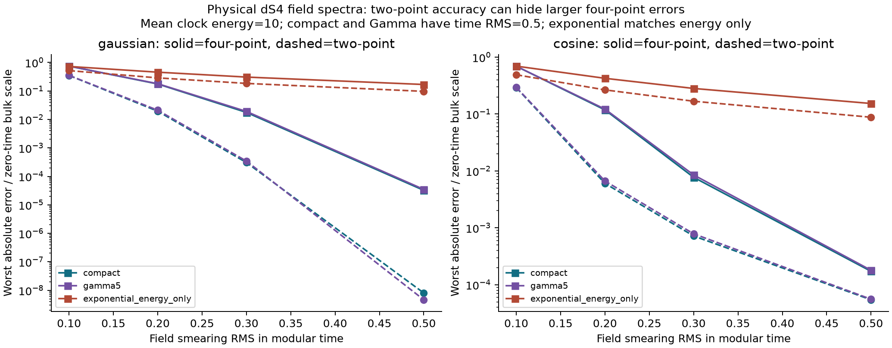

# 真实场谱中的二点和四点钟资源

2026-10-29。第二阶段研究记录：选定 dS₄ 共形自由场，推导同一量子钟压缩下的二点与四点多项式矩，并计算 72 组资源对照。实际 dS₄ 自由场的算符接口已补齐：[静态管近似](stage2-localization-bridge.md)证明全部所用窗口的局域 Weyl 归属，[压缩场证明](stage2-weyl-bridge.md)给出自伴性、角代数附属关系及共同钟混合导数。标准 BD 静态模流与 crossed-product 构造仍作为既有物理输入；有限 G 与反冲尚未接入。72 组数值经修正后通过 328 项独立检查，0 失败；具体检查及容差见 [validation.json](../results/stage2/validation.json)。

## 主要认识

在这一模型里，两点准确不能保证四点同样准确。四点经历的是一条共同的中间能量路径，有些通道需要两次正能量累加；分别给两点函数乘核后再做 Wick 配对，会漏掉这种约束。该区别在实际 dS 场谱中可计算，在单谐振子 KMS 例子中也有严格反例。

时间涂抹使场谱总质量有限，但不产生硬频率截止。严格有限时长的 cos² 窗口仍有代数谱尾；Gaussian 有更快谱衰减，但时间支撑无限。改变涂抹改变的是整个观测任务，不能只说某个窗口全面优于另一个。

## 模型与约定

对象是四维 de Sitter 上的实、自由、无质量、共形耦合标量，Bunch–Davies 态，中心测地世界线。取 β=2πL、s=τ/β、E=βω。由[原始场谱核验](../literature/stage2-field-spectrum.md)，

\[
W(s)=-\frac{1}{4\beta^2\sinh^2\pi(s-i0)},\qquad
W(s)=\int_{\mathbb R}\rho(E)e^{-iEs}dE,
\quad \rho(E)=\frac{E}{4\pi^2\beta^2(1-e^{-E})}.
\]

ρ 是双侧正谱，满足 ρ(−E)=e⁻ᴱρ(E)。探测器正能隙激发响应抽取负频率，不能不改符号就把它当作此处的模谱。

场按实窗口 f 分别时间涂抹，ρf=ρ|f̂|²，Z=∫ρf，A=φf/√Z。于是背景 C₂(0)=1、C₄(0,0,0,0)=3。比较窗口使用同一个时间 RMS σ：

- Gaussian：f̂(E)=exp(−σ²E²/2)，无限时间支撑。
- cos²：f(u)=cos²(πu/2T)/T，|u|≤T，T=σ/√(1/3−2/π²)。零延拓 C¹、H²；它不是 C∞，也不适用于任意未重整化复合场。

场涂抹 RMS 与量子钟读时 RMS 是两个独立参数。σ=0.3 对应物理涂抹 RMS≈1.885L；本轮钟读时 RMS=0.5 对应 πL，并非任意精密的瞬时实验。

## 可精确计算的任务误差

记 μ(dE)=ρf(E)dE/Z，X、Y 独立服从 μ，K(q)=Pr(p≥q)。三种 Wick 配对的最大正中间能量分别为

\[
q_{12}=\max(0,X,Y),\qquad
q_{13}=X_++Y_+,\qquad
q_{14}=[X+Y_+]_+.
\]

四点的三维谱是三个二维测度的推前，含 δ 支撑；它不是普通三维 L¹ 密度。对于同一个实涂抹场，这些谱测度在共同零时为正，总质量恰为 3。因此全部实时间的最坏误差为

\[
\mathcal E_2=\sup|C_2^P-C_2|=\mathbb E[1-K(X_+)],
\]

\[
\mathcal E_4=\frac13\sup|C_4^P-C_4|
=\frac13\sum_{j=12,13,14}\mathbb E[1-K(q_j)].
\]

共同时间时所有相位为 1，确实饱和这些界。这里除以固定的背景零时尺度，**不是逐时刻相对误差**。固定场与固定 H 的这一结论不包含有限 G 增强项，也不排除其他模型中的反冲或反扰乱。

[独立推导](stage2-wick-measures.md) 给出全部相位、CDF 降维和谱尾公式。新增的[算符证明](stage2-weyl-bridge.md)在实际 BD 完整 Fock 表示上保留每个中间投影，证明这些矩同时是指定角代数中有界 Weyl 产品的真正混合导数；压缩场的自伴闭包附属于该角代数。

## 代表性计算

Gaussian σ=0.3、平均钟模能量 ⟨p⟩=10。紧支撑钟与 Gamma5 钟均取协变时间 POVM RMS=0.5；指数钟只匹配平均能量，它的时间方差发散。

| 钟态 | 二点最坏绝对误差 | 四点最坏绝对误差除以 3 |
|---|---:|---:|
| 紧支撑 sin² 波函数 | 0.0003061 | 0.01761 |
| 平移 Gamma5 | 0.0003454 | 0.01909 |
| 指数分布，仅均值匹配 | 约 0.1836 | 约 0.3064 |

紧支撑例的两个数字相差约 58 倍。它在阈值 Q≈6.3724 以下精确恢复谱核，但实际场谱仍有高能尾。C₄(0)−3C₂(0)²≈−0.0510，显示同钟压缩后的矩不再保留原场的 Gaussian 因子化；这不是引力相互作用产生的非高斯性。

完整表包括两类窗口、σ={0.1,0.2,0.3,0.5}、均值={5,10,20} 和三类钟，共 72 组。某些窄涂抹、低预算任务中指数族的四点误差反而较小，因此这里只报告任务依赖的比较，不声称紧支撑族普遍最优。两类有限 RMS 钟也未匹配全部资源：Gamma 有无限高能尾，紧支撑钟有硬能量上限；相同均值与 RMS 不等于相同所有物理成本。



## 谱窗充分界有多松

在紧支撑钟的下沿 Q≈6.3724，δQ=0，第一阶段谱窗充分界直接等于任务谱尾。独立 CDF 计算给出：

| σ=0.3 的窗口 | 二点谱尾上界 | 实际二点误差 | 四点谱尾上界除以 3 | 实际四点误差除以 3 |
|---|---:|---:|---:|---:|
| Gaussian | 0.017639 | 0.0003061 | 0.15024 | 0.017614 |
| 有限时长 cos² | 0.0040035 | 0.0007196 | 0.098114 | 0.0077279 |

实际核在 Q 以上逐渐减小，并非立即为零，因此真实误差显著小于硬窗口上界。完整尾值和数值截断条件见 [tails.json](../results/stage2/tails.json)。这两行比较的仍是不同涂抹任务，不能据此宣称一个窗口普遍更优。

## 时间曲线与热性

所绘乱序量是字面顺序 A(t)A(0)A(t)A(0)，不是插入四段热密度矩阵的 regulated OTOC。代码保存复数实部、虚部和绝对误差。曲线上限在共同零时达到；一个晚时常数项可以被钟核改变，这不构成混沌或引力增长的证据。

未压缩场谱的 KMS 详细平衡用于核对 Fourier 方向。所选有限钟态的压缩谱一般不再满足同一 KMS 关系：对 E>0，ρfᴾ(E)=K(E)ρf(E)，ρfᴾ(−E)=ρf(−E)。因此在 K(E)>0 时，ρfᴾ(−E)=e⁻ᴱρfᴾ(E)/K(E)。这是当前状态和可观测量选择的性质，不是有限 G 静态补丁迹字典已被检验或修复。

## 数值证据怎样使用

[研究脚本](../code/run_field_study.py) 使用稳定谱尾的分段 Gauss–Legendre 内积分，再对钟密度作自适应积分，并保存频率及钟积分尾界。[独立验证](../code/validate_field.py) 另用 q 密度自适应积分、CDF 和模型反例检查。谱截断上界不等于全部数值误差：q₁ 在 X=Y 处的折点、窗口端点与极小误差的浮点相消都要单独控制。

修正后，生产积分与独立 q 密度积分的最大二点差为 7.77×10⁻¹⁶，四点归一化差为 1.65×10⁻¹³。它们是算法一致性差值，不能代表物理总精度：本批有限时长场的全谱截断上界最大仍为二点 2.17×10⁻⁸、四点归一化 4.34×10⁻⁸。外积分误差估计也不是区间算术认证。

double 精度输出中极小于 10⁻¹² 的误差，不用于宣称同量级相对精度；接近零的四阶累积量尤其可能丢失有效数字。表格的代表性结论使用远高于这一尺度的数据。独立验证若对某类基线给出较宽容差，应按实际容差报告，不把所有 CSV 位数都当成有效数字。

复算：

```powershell
python code/run_field_study.py
python code/validate_field.py
```

参数与代码 SHA-256 在 [study.json](../results/stage2/study.json)，数值对照在 [errors.csv](../results/stage2/errors.csv)。旧的 235 项钟模型验证只属于第一阶段，不替本阶段背书。

## 算符接口的完成依据

[字典 A](stage2-localization-bridge.md)显式构造静态补丁内的实光滑时空测试函数，并在完整 BD 单粒子交叉范数中收敛到世界线窗口。cos² 窗先光滑化；Gaussian 先截断时间，再随截断选择空间管宽。Gaussian 归属于包含整条世界线的管代数，不能据此称作有限时间局域。

[字典 B](stage2-weyl-bridge.md)在同一个实际 Fock 表示上，用粒子数估计证明共同钟压缩场本质自伴，再从角代数内有界中心差商的强 resolvent 极限证明附属关系。多变量整向量展开控制至多四次插入的真混合导数，并给出空间逼近和差商的联合图范数界。该控制对任意归一化 L² 钟一致，不要求额外钟能量矩；使用的静态演化保持辅助粒子数。

压缩 Weyl 一般仍不是压缩场的指数。辅助的[有限矩阵验证](../results/stage2/operator-bridge-validation.json)通过 24 项检查，包括差商、一个参考向量上的 resolvent 和非乘法性。它只是公式与实现的对照：有限振子截断不满足严格 CCR，不能替代上述无限维证明。初版探针的低阶抵消已另存诊断，未用放宽容差掩盖。

[原物理审查](stage2-physics-audit.md)保留提出缺口时的论证，顶部链接到本轮补证。这里完成的是指定自由模型的算符识别，没有重新证明一般 type 分类或有限 G 动力学。

## 下一步

进入[量子观察者质量与制备字典](../literature/stage3-quantized-observer-dictionary.md)，在 dS₂ 的明确有限质量模型中计算正规化波包，并区分单观察者的相位盲区和双观察者的相干任务。[dS₃ 纯反冲基线](stage3-baseline.md)与[有限 G 双共形基线](stage4-conformal-setup.md)另保留作对照；跨维度及跨模型接口仍需证明，不能直接给其 OTOC 乘 K(q)。
