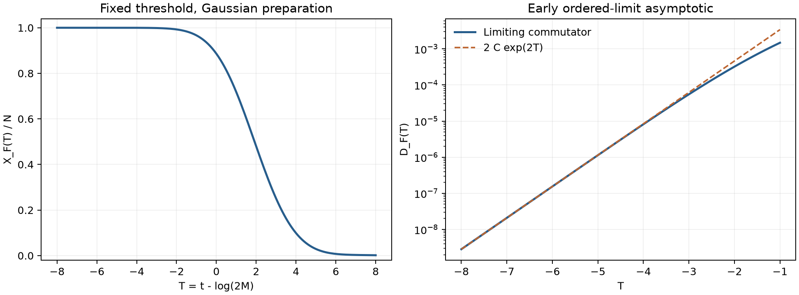

# Gaussian 制备与移动硬阈值的角点尾

2026-10-30。[正式稿](../manuscript/preparation.tex)为第13节，接续[对数时间极限](stage3-logarithmic-time.md)。这是作者自查的证明草稿；尚未独立认证，未确认首创性。原文指数2与Gamma/Fourier方法的前驱见[来源记录](../literature/stage3-preparation-sources.md)。

## 模型与结论范围

沿用dS₂、L=1、proper SO⁺(2,1)、严格G_N→0、BD自由场、两独立等principal-series物质ν>0、固定proper Gaussian宽σ>0、真空正规化外部质量包m=M+r。固定协议F每次阈值m_*>1/2，移动协议Q每次阈值M≥1。先M→∞，t_M=log(2M)+T，再研究T→−∞；不把结论直接升级成有限M增长窗口的指数。

F适用第12节任意固定L¹外态，其极限与π₀无关。本轮Q的速率结论专门取π₀(r)=β exp(−βr)，r≥0、β>0。这个条件比第12节的存在性定理更强，必须保留。

## 完整外腿后的分离

取χ=x−y+z、u=x−χ/2、v=z−χ/2，故y=u+v、Q=2u²+2v²+χ²，Jacobian绝对值为1。令

\[
f_\chi(w)=e^{-\pi w-\sigma^2w^2}
\prod_{\epsilon,\eta=\pm1}
\Gamma\left(\frac14+\frac{i\chi}{4}+\frac{i\eta}{2}(w+\epsilon\nu)\right),
\quad J(\chi)=\int_{\mathbb R}f_\chi(w)dw.
\]

将V₋中的c比值与Hν的八个Gamma逐项约去后，得到

HνV₋ exp(−σ²Q/2)/π³ = 2^(2iχ) cosh(πχ/2) exp(−σ²χ²/2) fχ(u)fχ(v)/(512π⁷)。

所有复相位保留；二次幂2^(2iχ)不能遗漏。F的横向积分成为J²，而K=J(0)/(16π³)=∫k、N∞^F=K²。定义

A_F(χ)=2^(2iχ) Γ(−iχ) cosh(πχ/2) exp(−σ²χ²/2) J(χ)²/(512π⁷)，

则X_F(T)=K²/2+PV∫ exp(iTχ)A_F(χ)dχ。减去iK² exp(−χ²)/(2πχ)后得到普通积分，减奇项的Fourier变换为−K² erf(T/2)/2。该表达保留完整物理Gaussian，不再是一维任意测试切片。

## F：固定 Gaussian 仍有指数2

在任意固定下半平面条带，fχ的Gamma参数实部≥1/4，Euler积分及其对数矩给统一界；w的Gaussian保证J全纯且有界。外层Gaussian控制实χ无穷远。Γ(−iχ)cosh(πχ/2)=2^(−iχ−1)√π Γ(−iχ/2)/Γ((1+iχ)/2)，所以奇数负虚轴极点准确消掉。

把PV轮廓下移到Imχ=−h，2<h<4。顺时针方向给零极点的半残数以及χ=−2i的全残数，得到

\[
X_F(T)=K^2-C_{\nu,\sigma}e^{2T}+O_h(e^{hT}),\qquad
D_F(T)=2C_{\nu,\sigma}e^{2T}+O_h(e^{hT}),
\]

\[
C_{\nu,\sigma}=\frac{e^{2\sigma^2}}{32\pi^6}J(-2i)^2>0.
\]

J(−2i)的实积分是e^(−πw−σ²w²)乘两对实部3/4的Gamma模平方，严格正。该指数属于指定真空对易子范数、既定时间零点和先M后T的极限；没有有限M统一误差时，不声称任意有限质量时间窗口已测得Lyapunov指数。σ→0或∞也没有统一性结论。

## Q：不能把硬边界移到复轮廓上

在固定r下，u,v区域为u,v≥−r−χ/2且u+v≥−r。令a=−r−χ/2、L=r+χ。两个半直线的平方区域需要减去一个三角形，但只在L>0时才有该三角形：

I(r,χ)=[∫_a^∞ fχ(w)dw]²−(L₊)² B(r,χ)，

B(r,χ)=∫_{s,t≥0,s+t<1} fχ(a+Ls)fχ(a+Lt)dsdt。

把L₊²临时换成L²定义一个光滑参考J_sm(χ)，并非更改实验协议。实际J_Q与它之差精确为

1_{χ<0}∫₀^(−χ) β exp(−βr)(r+χ)²B(r,χ)dr。

设χ=−h、r=hρ，h>0，测度及L²给h³；单位单纯形在h=0的面积为1/2，∫₀¹(1−ρ)²dρ=1/3。因此

J_Q−J_sm = β f₀(0)² (−χ)₊³/6 + O((−χ)₊⁴)，带相应的单侧导数余项。

乘Γ(−iχ)=i/χ+O(1)后，谱振幅新增

−i a₀χ²1_{χ<0}，a₀=βf₀(0)²/(3072π⁷)。

减掉PV奇部后，振幅C¹，二阶导数从左到右跳跃2ia₀。两半轴分部积分给Fourier领先项2a₀/T³；四阶单侧导数可积给O(|T|⁻⁴)。全局支配来自Gaussian、Gamma对数矩界及指数密度的全部r矩，不能只凭局部Taylor式就推断远端Fourier尾。

记B_{β,ν}=β|Γ(1/4+iν/2)|⁸/(1536π⁷)>0，则

\[
X_Q(T)=X_\infty^Q+\frac{B_{\beta,\nu}}{T^3}+O(|T|^{-4})\quad(T\to-\infty),
\]

\[
X_Q(T)=\frac{B_{\beta,\nu}}{T^3}+O(T^{-4})\quad(T\to+\infty),
\]

\[
D_Q(T)-D_{\rm edge}=\frac{2B_{\beta,\nu}}{|T|^3}+O(|T|^{-4})\quad(T\to-\infty).
\]

这里的领先项在减掉静态底值后仍是幂律。系数来自r=u=v=χ=0处，Gaussian恰好等于1，所以对固定σ>0它不显含σ；有效渐近时间和误差常数仍依赖σ。结论不适用于任意π₀；例如在r=0消失的密度会改变角点阶数，需另算。

## 可复算数值

[代码](../code/preparation_asymptotics.py)、[原始输出](../results/stage3/preparation/diagnostics.json)保存37项诊断。ν=.6、σ=1、β=1；代数和独立标量积分45位，实际曲线使用SciPy双精度loggamma与分区Gauss–Legendre 24/40/64点。w和χ截断到±12，保留复值，不先取实部。

K²≈.02209171019693236，C_F≈.01259281368446321，Q的2B≈.00023770257895248。F在T=−8、−6、−4的(N−X)/(C_F exp(2T))约为.999981、.999020、.969004。

实轴减奇积分与Imχ=−3轮廓在T≤0相符。正T的下移轮廓有严重大数抵消，因此该值只保存为诊断，不用作曲线主值；T=6时经验差约5.3×10⁻¹¹，不能把这一不稳定表示称为高精度交叉认证。

J的|w|>12解析尾表达估计约5.63×10⁻⁴⁶；实轴A的|χ|>12解析尾表达估计约2.72×10⁻³²。常数用普通浮点计算，未做向外舍入；两项是单独尾界，不是整个减奇求积的认证误差。盒内24/40/64点变化仍为经验等级。

Q仅核局部角点：把三角形及r积分缩放到单位立方体，以12/20点逐维加阶。∆J/[h³βf₀(0)²/6]在h=.2时约.7151+.6417i，在h=.005时约.99859+.01807i，支持复振幅趋于1。没有计算完整Q时间曲线，不能将这些角点样本冒充完整波包的幂律数值验证。

## 下一步

优先构造Q的分区PV积分并作完整曲线核对，特别是早期D−D_edge的小差分。再分析π₀在阈值处的消失阶数与支撑间隙，区分角点幂律、振荡尾和可能保留的指数窗口。另需建立有限M增长窗口的误差，才能把两次取极限的结果与有限质量观察者直接联系。有限G动力学与完整对偶仍开放。
